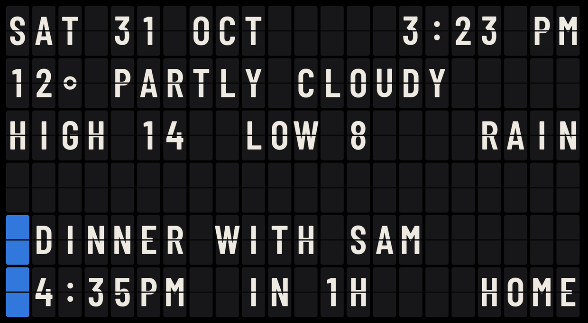
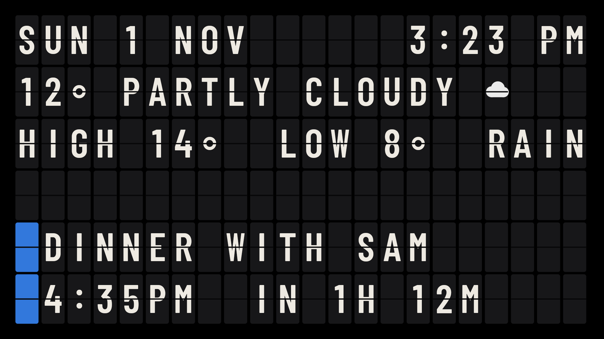
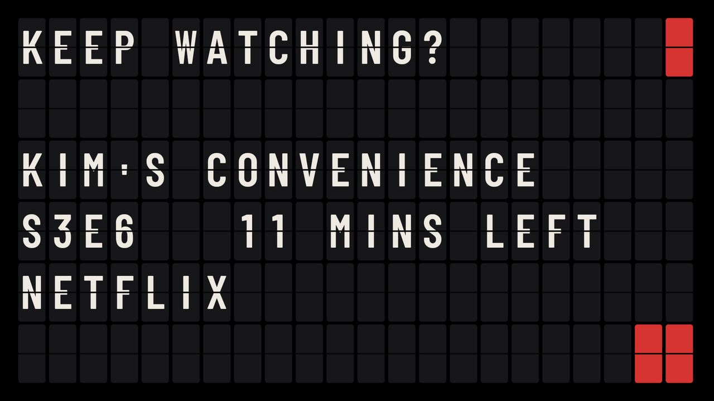
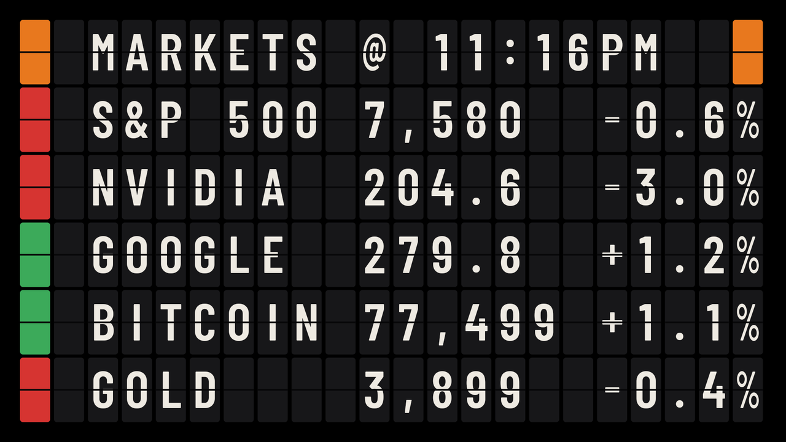
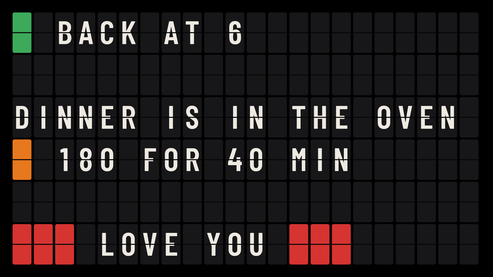

<p align="center">
  
</p>

<p align="center"><b>The split-flap board you always wanted, on the TV you already own.</b></p>

<p align="center">Departures turns an Android TV or Google TV into a personal Vestaboard-style board: the date and time, today's weather, what's next on your calendar, the show you left half-watched, the markets, and a message of your own, each flipping into place as it changes. Run it as the screensaver, or as an app that stays on all day.<br>Ten minutes to set up, from a page the TV serves on your Wi-Fi. No accounts: everything is hosted locally on your TV.</p>

<p align="center">
  <a href="LICENSE"></a>
  <a href="https://github.com/0xdravyn/departures/stargazers"></a>
  <a href="https://github.com/0xdravyn/departures/actions"></a>
  <a href="https://buymeacoffee.com/dravyn"></a>
</p>

## Start here

| You want | Go to |
|---|---|
| **To see it** | [What you get](#what-you-get), the four views from a real TV |
| **To install it with a coding assistant** | [`PROMPT.md`](PROMPT.md): paste it into Claude Code or Codex and it installs the app for you |
| **To install it by hand** | [Setup instructions](#setup-instructions): a few ADB lines, then a web page |
| **To know what it reads and sends** | [Security](#security) and [`SECURITY.md`](SECURITY.md) |
| **To change or extend it** | [`CONTRIBUTING.md`](CONTRIBUTING.md): the rules, and how to add a view |

## What you get

A 22 by 6 board of flaps on a true black background, so an OLED keeps most of its pixels off. Four views take turns. Tiles flip only where a character changed, in a wave from the left, and there is no clatter: a living room should stay quiet. Quiet hours dim the board at night, and the whole thing costs the TV next to nothing.

| Today | Keep watching? |
|---|---|
|  |  |
| Date and time, the weather now, today's high and low, and RAIN when rain is likely later in the day. Below, what's next on your calendars: the event running now, else the next to start, then the following one as each ends. Once today is done, tomorrow's first event. Or, in place of the calendar rows, two lines of your own. | The newest resume entry across your streaming apps (Android TV's Watch Next table), when there is one. |
| **Markets** | **Custom message** |
|  |  |
| Up to five assets with the day's change, green or red. Each carries the name you give it (S&P 500 for ^GSPC) or its symbol. The change is against the previous close for stocks, indices and futures, and the last 24 hours for crypto; outside an exchange's session a row simply stops moving. Quotes refresh every ten minutes, and once more half-way through each Markets view. | A full board of your own: six lines of 22, with the seven colour chips (a colour emoji becomes the nearest chip). Written on the settings page with a live preview, shown in the rotation while it has something to say. |

The clock, the date and your message work offline; the weather, calendars and markets need Wi-Fi, and the last readings stay on the board while it is down. The screenshots are the app's demo mode, with sample data.

## Run it as an app or a screensaver

**As an app.** Open Departures from the home screen; it holds the screen on until you press Back. Good for a bar, a shop, a studio or a hallway. Some TVs switch off after a few hours without a remote press whatever is running (Sony: Settings > System > Power > Idle TV standby); turn that off for all-day use.

**As the screensaver.** Departures starts on its own once the TV has sat idle, two minutes by default. Google TV's own screen saver page lists only Google's modes, so this takes two permission grants over ADB the first time (step 2 below). After that, one button on the settings page or two rows on the TV turn it on and off. The TV's own sleep timer still applies, as with any screensaver.

## Setup instructions

About ten minutes: a few commands from a computer to install the app, then everything else from the web page the TV serves on your Wi-Fi.

You need an Android TV or Google TV on Android 8.0 or newer (built on a Sony BRAVIA with Google TV 12; Samsung, LG and Fire TV cannot run it), a computer on the same Wi-Fi, `adb` (Android platform tools), and USB debugging switched on in the TV's Developer options (Settings > System > About, press OK on the build number seven times, then back one level).

1. **Install.** Download `departures-v0.1.1.apk` from the latest [release](https://github.com/0xdravyn/departures/releases), or build it yourself (`./gradlew assembleRelease`, JDK 17 and the Android SDK), then:
   ```bash
   adb connect <tv-ip>:5555
   adb install -r departures-v0.1.1.apk
   ```
   If Departures does not appear on the home screen (TVs with a second profile keep per-user install state), run `adb shell pm install-existing --user 0 app.departures.tv`.
2. **Grant what it cannot ask for itself**: Watch Next for the Keep watching? view, and the two settings that let it become the screensaver.
   ```bash
   adb shell pm grant app.departures.tv android.permission.READ_TV_LISTINGS
   adb shell pm grant app.departures.tv android.permission.WRITE_SECURE_SETTINGS
   adb shell appops set app.departures.tv WRITE_SETTINGS allow
   ```
3. **Open Departures on the TV.** The board shows an address and a code. Open the address on your computer, enter the code, fill in the Content tab and press APPLY. On the Settings tab, **Enable screensaver mode** if you want it. Then switch USB debugging off again.

Without step 2, Keep watching? stays off and the screensaver switch is two ADB lines instead: `adb shell settings put secure screensaver_components app.departures.tv/.DeparturesDream` and `adb shell settings put system screen_off_timeout 120000` (two minutes).

**Over ADB instead of the page.** Copy [`config.example.json`](config.example.json), fill it in (`location`, `calendars` with their secret iCal addresses, `markets`, `today`, `message`), then `adb push config.json /data/local/tmp/departures-config.json`, `adb shell am start -n app.departures.tv/.ImportActivity`, `adb shell rm /data/local/tmp/departures-config.json`.

**Kiosk use.** For a board that comes back by itself after a power cut, let the home screen start it: the [CleanYourTV](https://github.com/Gathin23/cleanyourtv) launcher can open an app at every power-on (`open_on_start`); Android itself does not let an app start a screen from the background on TVs. On the TV, switch off every view but the one you want, turn quiet hours off if you are open late, and switch off the TV's idle standby.

## Settings

The TV serves it on your Wi-Fi while the board is on screen. Hold OK on the board (or press the remote's Menu button) and the first row shows the address (`http://<tv>:8787`) and a four-digit code; a TV with nothing set up yet shows them on the board itself. Open the address on a computer, enter the code, and everything is there in two tabs:

- **Content**: your city (type it, pick it from the list), 12 or 24-hour clock, Celsius or Fahrenheit, up to three calendars (name and secret address, with a Test button), two lines of your own in place of the calendar rows, the custom message with a live preview, and up to five markets, each looked up before it reaches the board.
- **Settings**: which views and for how long, the flip animation, seconds on the clock, brightness, quiet hours, and screensaver mode with its idle delay.

Each tab has its own reset. The TV checks the code on every request; your computer remembers it for thirty days. Calendar addresses go in and never come back out.

**On the TV itself.** The same Settings tab, with the remote: hold OK on the board. One row per view, the flip animation, seconds, brightness, clock, units, quiet hours, screensaver mode and the idle delay, plus the address and code (OK on that row makes a new code). The app and the screensaver share these settings.

## Security

Departures runs entirely on the TV. The settings page is served on your local network only, behind the code on the TV screen, and calendar addresses are stored on the TV and never returned to the page. It fetches your calendars from the secret addresses you give it, weather from [Open-Meteo](https://open-meteo.com/) (no account, no key), quotes from Yahoo Finance's public chart endpoint (unofficial, delayed) and CoinGecko's free price API (no key), and reads the TV's own Watch Next table. There is no server of ours, no account, no analytics and no self-updater. The full picture, and how to report a problem: [`SECURITY.md`](SECURITY.md).

## Restoring your TV

```bash
adb shell settings put secure screensaver_components com.google.android.apps.tv.dreamx/.service.Backdrop   # Google TV's own screensaver
adb uninstall app.departures.tv
```

Uninstalling removes the configuration with it. Nothing else on the TV was changed.

## Contributing

Issues and pull requests are welcome; [`CONTRIBUTING.md`](CONTRIBUTING.md) has the short rules: nothing personal in git, no new permissions without a README line, keep the board honest, test on a real TV. New views are the contribution this project most wants: one small method over a plain 22 by 6 grid, and a week view and a quotes view are already on the list.

## Support

I love coffee, so if Departures earned a place on your wall, [buy me one here](https://buymeacoffee.com/dravyn) :)

## Licence

MIT. The bundled font is Barlow Condensed (SIL Open Font License 1.1); see `app/src/main/assets/fonts/OFL.txt`. Departures is an independent project with no affiliation to Vestaboard, Inc.
