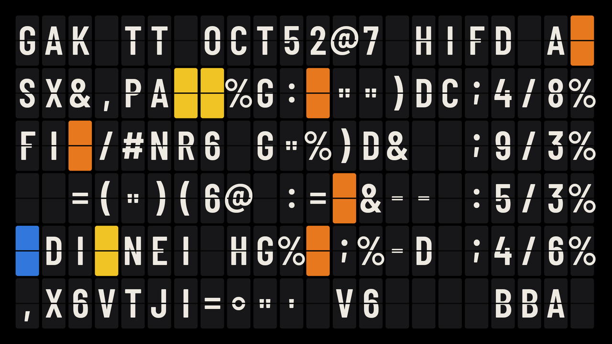

<p align="center">
  
</p>

<p align="center"><b>A split-flap departure board for your TV.</b><br>
Date, time, the weather, what's next on your calendar, what you were watching, the markets, and a message of your own, flipping in place as they change.</p>

<p align="center">
  <a href="LICENSE"></a>
  <a href="https://github.com/0xdravyn/departures/stargazers"></a>
  <a href="https://github.com/0xdravyn/departures/actions"></a>
  <a href="https://buymeacoffee.com/dravyn"></a>
</p>

Runs on Android TV and Google TV (Android 8.0 and newer): as the **screensaver**, or as an **app** that stays on all day. Set up from a web page the TV itself serves on your Wi-Fi. No account, no server, no analytics. Everything you enter is stored locally on the TV.

## Start here

| You want | Go to |
|---|---|
| **To see it** | [What you get](#what-you-get), three screenshots from a real TV |
| **To install it with a coding assistant** | [`PROMPT.md`](PROMPT.md): paste it into Claude Code or Codex and it installs the app for you |
| **To install it by hand** | [Setup](#setup): four ADB lines, then a web page |
| **To know what it reads and sends** | [Your data stays yours](#your-data-stays-yours) and [`SECURITY.md`](SECURITY.md) |
| **To change or extend it** | [`DESIGN.md`](DESIGN.md) for the decisions, [`CONTRIBUTING.md`](CONTRIBUTING.md) for the rules |

## What you get

A 22 by 6 board of flaps, full screen on a true black background (on an OLED those pixels are off). Four views take turns; bits flip only where a character changed, in a wave from the left, and there is no sound.

| Today | Keep watching? | Markets |
|---|---|---|
|  |  |  |
| Date and time (the minutes flip), the weather now with today's high and low, and what's next on your calendars today: the event running now, else the next to start, each giving way to the following one as it ends. Once today is done, tomorrow's first event. Or, instead of the calendar rows, two lines of your own. | The newest resume entry across your streaming apps (Android TV's Watch Next table), when there is one. | Up to five assets with the day's change, green or red, under a `MARKETS @ time` header. Defaults: S&P 500, NVIDIA, Google, Bitcoin, gold. |

**Custom message**, the fourth view: a full board of your own, six lines of 22, with the seven colour chips (a colour emoji becomes the nearest chip). Written on the setup page, shown in the rotation while it has something to say. Markets carry the name you give them on the page (S&P 500 for ^GSPC), or the symbol.

Quiet hours dim the board at night. The screenshots are the app's demo mode, which uses sample data.

## Two ways to run it

**1. As an app, whenever you want it.** Open Departures from your home screen. It holds the screen on and runs until you press Back. Nothing to set up beyond the configuration. For a bar, a shop, a studio or a hallway: some TVs add an "idle standby" that switches off after a few hours without a remote press whatever is running (Sony: Settings > System > Power > Idle TV standby); turn it off for all-day use.

**2. Screensaver mode.** Departures replaces the TV's built-in screensaver and starts on its own after the TV has sat idle, by default **2 minutes with no remote input**. Google TV's own Screen saver page does not list third-party screensavers, so this needs two permission grants over ADB the first time ([Setup](#setup), step 2); after that, one button on the setup page (**Enable screensaver mode**, with the idle minutes beside it) or two rows in the TV's own settings control it, and undo it. The TV's own sleep timer still applies afterwards, as with any screensaver.

## The setup page

Departures serves its own setup page on your Wi-Fi while it is on screen: open Departures on the TV, hold OK, and the first row shows the address (`http://<tv>:8787`) and a four-digit code. Open the address on a computer on the same network, enter the code, and everything is there in two tabs:

- **Content**: your city (type it, pick it from the list), 12 or 24-hour clock, Celsius or Fahrenheit, up to three calendars (name and secret address, with a Test button), two lines of your own in place of the calendar rows, the custom message board with a live preview, and up to five markets, each looked up before it reaches the board.
- **Settings**: which views and for how long, the flip animation, the random scatter effect (a few blank tiles flip on their own now and then), seconds on the clock, brightness, quiet hours, and screensaver mode with its idle delay.

Each tab has its own reset. The TV checks the code on every request; the page remembers it on that computer for thirty days. Calendar addresses go in and are never shown or sent back out. A TV with nothing set up yet shows the address and code on the board itself.

## Settings on the TV

Hold OK on the board (or press the remote's Menu button). The same settings as the page's Settings tab, with the remote: one row per view (how long it stays, or Off; the last view on cannot be switched off), the flip animation, the scatter effect, seconds on the clock, brightness, clock, units, quiet hours, screensaver mode and the idle delay, plus the setup address and code (OK on that row makes a new code). The app and the screensaver share these settings.

## Setup

What you need: a computer on the same Wi-Fi as the TV, `adb` (Android platform tools), and USB debugging switched on in the TV's Developer options (Settings > System > About, press OK on the build number seven times, then back one level).

1. **Install the APK.** Take `app-release.apk` from the latest [release](https://github.com/0xdravyn/departures/releases) or build it yourself (`./gradlew assembleRelease`, JDK 17 and the Android SDK), then:
   ```bash
   adb connect <tv-ip>:5555
   adb install -r app-release.apk
   ```
   If the home screen does not show Departures afterwards (TVs with a second profile keep per-user install state), run `adb shell pm install-existing --user 0 app.departures.tv`.
2. **Grant the three permissions it cannot ask for itself** (Watch Next for Keep watching?, and the two screensaver settings, because Google TV's own Screen saver page lists only Google's modes):
   ```bash
   adb shell pm grant app.departures.tv android.permission.READ_TV_LISTINGS
   adb shell pm grant app.departures.tv android.permission.WRITE_SECURE_SETTINGS
   adb shell appops set app.departures.tv WRITE_SETTINGS allow
   ```
3. **Open Departures on the TV.** The board shows the setup address and a code. Open the address on a computer on the same Wi-Fi, enter the code, fill in the Content tab, hit Apply; on the Settings tab, **Enable screensaver mode** if you want it. Switch USB debugging off again.

Without the grants in step 2, Keep watching? stays off and the screensaver switch is these two ADB lines instead: `adb shell settings put secure screensaver_components app.departures.tv/.DeparturesDream` and `adb shell settings put system screen_off_timeout 120000` (two minutes).

**Setting up over ADB instead.** The page writes the same `config.json` you can push by hand: copy [`config.example.json`](config.example.json), fill it in (`location`, `calendars` with their secret iCal addresses, `markets`, `today`, `message`), then `adb push config.json /data/local/tmp/departures-config.json`, `adb shell am start -n app.departures.tv/.ImportActivity`, `adb shell rm /data/local/tmp/departures-config.json`.

**Kiosk use.** For a board that comes back on its own after a power cut, let the home screen start it: the [CleanYourTV](https://github.com/Gathin23/cleanyourtv) launcher can open an app at every power-on (`open_on_start`); Android itself does not let an app start a screen from the background on TVs. Pin a face in Settings, turn quiet hours off if you are open late, and switch off the TV's idle standby.

## Your data stays yours

Departures runs entirely on the TV. Its setup page is served by the TV on your local network only, behind the code shown on the TV screen, and calendar addresses are stored on the TV and never returned to the page. It reads your calendars from the secret addresses you give it, fetches weather from [Open-Meteo](https://open-meteo.com/) (no account, no key), quotes from Yahoo Finance's public chart endpoint (unofficial, delayed) and CoinGecko's free price API (no key), and reads the TV's own Watch Next table. There is no server of ours, no account, no analytics and no self-updater. Outside an exchange's session its rows simply stop moving; crypto rows keep moving. The change is against the previous close for stocks, indices and futures, and the last 24 hours for crypto. Quotes refresh every ten minutes in the background and once more half-way through each Markets view, so a moving price flips while you watch; the sources may add their own delay. This is a wall board, not a terminal. Details and the reporting path: [`SECURITY.md`](SECURITY.md).

## Restoring your TV

```bash
adb shell settings put secure screensaver_components com.google.android.apps.tv.dreamx/.service.Backdrop   # Google TV's own screensaver
adb uninstall app.departures.tv
```

Uninstalling removes the configuration with it. Nothing else on the TV was changed.

## Questions people ask

**Why 22 by 6?** It is the geometry of the full-size split-flap boards people hang on walls, and a real constraint: every row is a 22-character headline. Text that does not fit is shortened, never shrunk.

**Why no sound?** A real board clatters; a TV in a living room should not. There is no sound and no option for it.

**Does it work on my TV?** Any Android TV or Google TV on Android 8.0 or newer should run it; it was built on a Sony BRAVIA (Google TV 12). Samsung Tizen, LG webOS and Fire TV cannot run it. If your TV behaves differently, open an issue with the model.

**What about burn-in?** The background is true black, the flaps are dark grey, and the board changes every minute. Quiet hours dim it further at night.

**Can it show something else?** Yes, and new views are the contribution this project most wants. A view is one small Java class over a plain 22 by 6 grid (`Faces.java`), plus a row in the settings; `CONTRIBUTING.md` says how, and `DESIGN.md` has what is on the list (a week view, a quotes view).

## The story

<!-- The maintainer's own words go here: the debloated TV, the Vestaboard that started it, why a screensaver. Keep it short. -->
*To be written.*

## Contributing

Issues and pull requests are welcome; read [`CONTRIBUTING.md`](CONTRIBUTING.md) first. The short version: nothing personal in git, no new permissions without a README line, keep the board honest, test on a real TV.

## Support

If the board earns a place on your wall, [buy me a coffee](https://buymeacoffee.com/dravyn). It keeps the TV on.

## Licence

MIT. The bundled font is Barlow Condensed (SIL Open Font License 1.1); see `app/src/main/assets/fonts/OFL.txt`.
